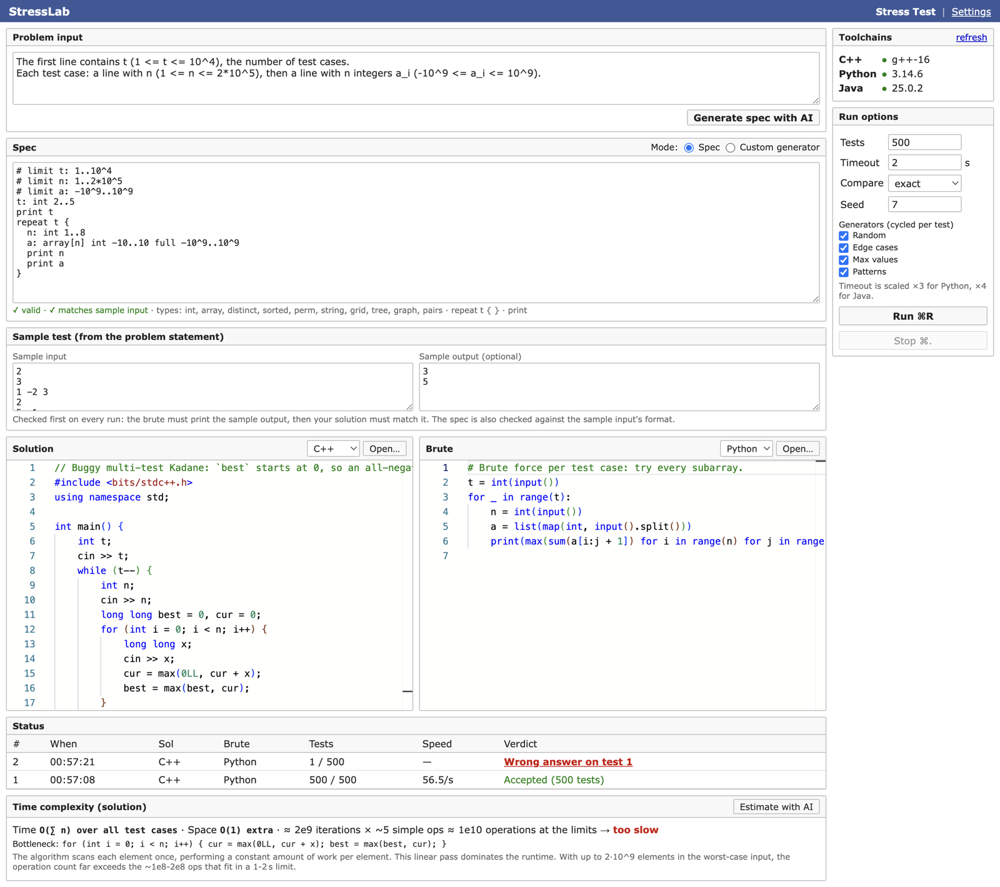
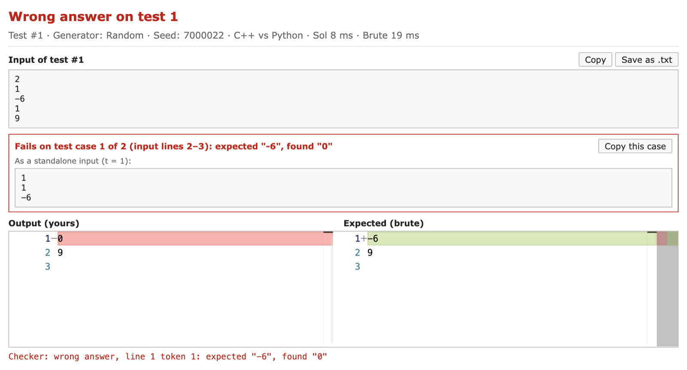
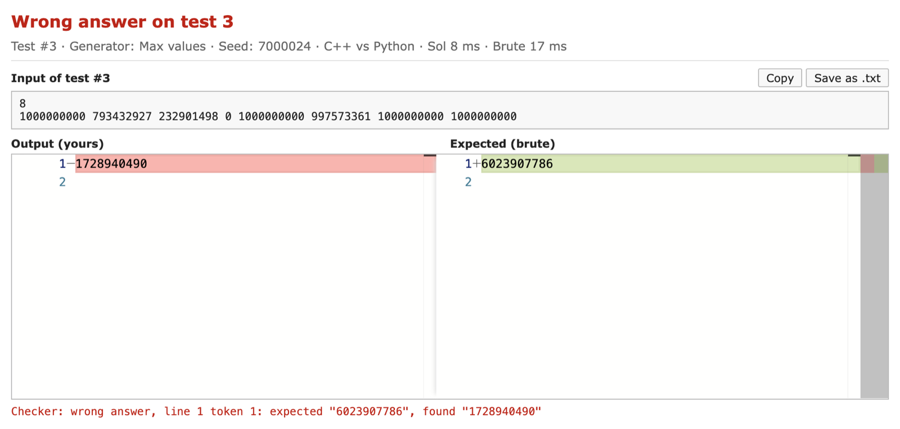
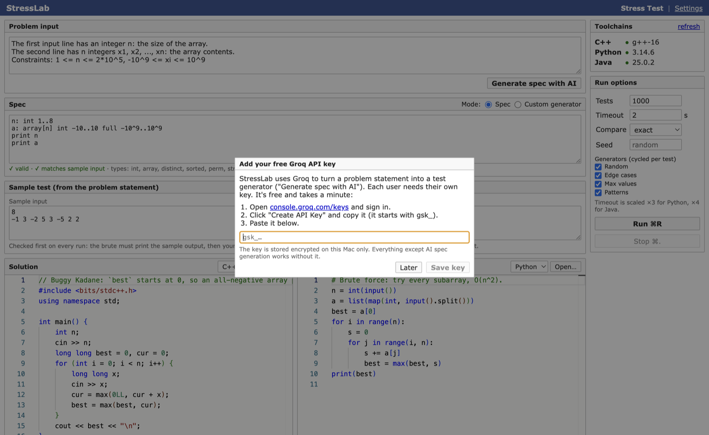
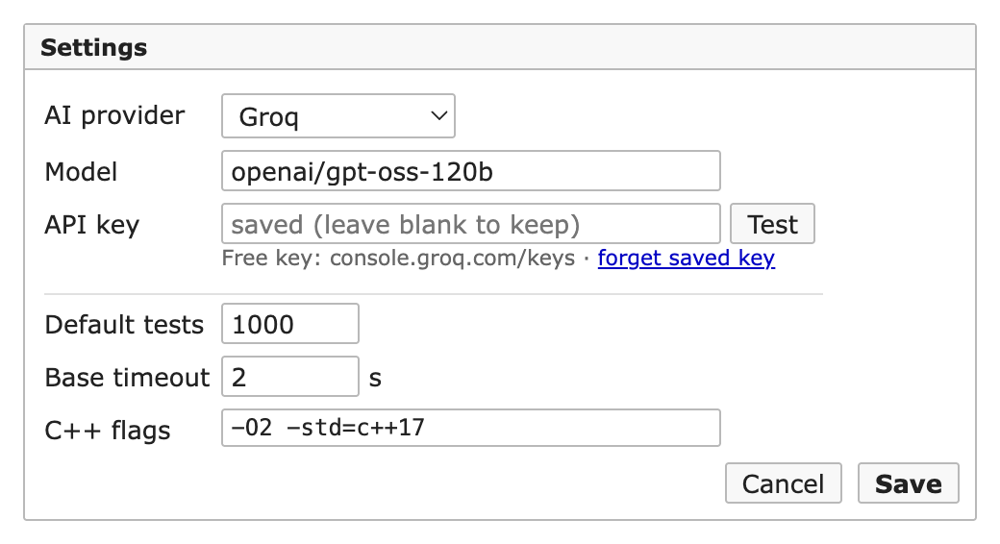

# StressLab

A macOS desktop app for **stress-testing competitive programming solutions**. Paste your solution and a slow-but-correct brute force (C++, Python or Java — they can differ), describe the input format (or let an AI write the description from the problem statement), press **Run**. StressLab generates random tests that start tiny and grow, runs both programs, and stops at the **first test where they disagree**, showing the input and a diff of the outputs.

Built with Electron for the *Application Development — Desktop Application* course project.

## Download

**[⬇ Download StressLab 1.0.0 for macOS (Apple Silicon, .dmg)](https://github.com/aristoncodes/stresslab/releases/latest/download/StressLab-1.0.0-arm64.dmg)** · [all releases](https://github.com/aristoncodes/stresslab/releases)

Open the .dmg, drag **StressLab** to Applications, then right-click it → **Open** the first time (the app is unsigned; see [Install](#install-the-dmg-unsigned-app)). On first launch it asks for a free [Groq API key](https://console.groq.com/keys) for the AI features; everything else works without one.

## Screenshots

**Main window** — problem → AI spec with real limits, live check against the sample, four test generators, status table and the AI time-complexity estimate:



| Failure window: the exact failing test case | Overflow caught by the *Max values* generator |
|---|---|
|  |  |

| First launch: bring your own free Groq key | Settings |
|---|---|
|  |  |

## Features

- Two Monaco editors (bundled offline) with per-editor language: **C++ / Python / Java**.
- Toolchain detection on startup: Homebrew `g++-NN` preferred, Apple Clang fallback (with a link test, so a broken install is reported instead of failing every run), `python3`, and a real JDK via `/usr/libexec/java_home`.
- Ships a `bits/stdc++.h` shim so CP-style C++ compiles with Apple Clang.
- **Spec language** → random generator with a seeded RNG, line-numbered errors and **small-first growth** (first failing test is usually tiny).
- **AI spec**: paste the problem's *Input* section → Groq (default) / Gemini / Ollama first lists every constraint's real limits (`# limit n: 1..2*10^5`), then writes the spec → the app parses it, checks that the spec keeps each size's real minimum and gives each value its `full MIN..MAX` range, checks it against the problem's **sample input**, and retries with the error (max 2 retries). Gemini automatically falls back to `gemini-flash-lite-latest` when `gemini-flash-latest` is overloaded.
- **Four test generators**, cycled per test: *Random* (small, growing), *Edge cases* (minimum sizes, values at min/max/±1/0), *Max values* (maximum independent sizes, values mostly at the problem's real limits, string contents and dependent sizes still random → catches `int` overflow) and *Patterns* (all-equal/sorted/reversed/alternating arrays, path/star trees, uniform strings). Toggle them in Run options.
- **Time complexity (AI)**: one click sends the solution and the `# limit` lines to the AI, which returns time/space complexity, the bottleneck code, an operation estimate at the limits and a verdict (*fits* / *risky* / *too slow*).
- **Sample test**: paste the statement's sample input/output. Every run checks it first (the brute must print the sample output, then your solution must match it), and the spec box shows live whether the spec matches the sample's format.
- **Exact failing case**: the failure window names the random test (#37, seed) and, for multi-test inputs, the failing **test case inside it** ("test case 3 of 5, input lines 6–7"), shown as a standalone `t = 1` input you can copy.
- Custom generator mode: your own generator program in any of the 3 languages (seed in `argv[1]`).
- Verdicts in Codeforces wording: *Accepted*, *Wrong answer on test N* / *on sample*, *Time limit exceeded*, *Runtime error*, *Compilation error*, *Brute failed*.
- Failure window with input, side-by-side diff, checker message, stderr/exit code for crashes; Copy and Save as .txt.
- Native menu + shortcuts, notifications, dock badge and dock progress bar, encrypted API key storage.

## Requirements

| Tool | Needed for | Install |
|---|---|---|
| macOS on Apple Silicon | the `.dmg` (arm64) | — |
| Xcode Command Line Tools | C++ (Clang fallback, linker) | `xcode-select --install` |
| Homebrew GCC *(recommended)* | C++ with real `g++` | `brew install gcc` |
| Python 3 | Python programs | `brew install python` |
| JDK 11+ | Java programs | `brew install openjdk` (then follow brew's `sudo ln -sfn …` hint so `java_home` finds it) |
| Node.js 20+ | building from source | `brew install node` |

Missing languages are shown as `○ none` in the sidebar with an install hint; the rest of the app keeps working.

> If C++ shows **broken**: your linker and SDK are out of sync (seen with an older Xcode.app selected). Fix with
> `sudo xcode-select -s /Library/Developer/CommandLineTools` or update Xcode, or just `brew install gcc`.

## Install the .dmg (unsigned app)

1. [Download the .dmg](https://github.com/aristoncodes/stresslab/releases/latest/download/StressLab-1.0.0-arm64.dmg), open it and drag **StressLab** to Applications.
2. The app is not signed/notarized, so macOS blocks the first launch. Either
   - right-click **StressLab.app → Open → Open**, or
   - run `xattr -cr /Applications/StressLab.app` in Terminal, then open it normally.

## Run from source

```bash
npm install
npm run dev          # app with hot reload
npm test             # generator tests + engine smoke test (no UI)
npm run build:mac    # → dist/StressLab-1.0.0-arm64.dmg
```

## Quick demo (preloaded on first launch)

1. The editors contain a **buggy** Kadane in C++ (`best` starts at 0) and an O(n²) Python brute for *Maximum Subarray Sum*; the spec is already filled in.
2. Press **⌘R** → *Wrong answer on test 1–3*, input `1 / -2`, and the failure window opens.
3. Fix the bug (`samples/maxsub/sol_fixed.cpp`) → *Accepted (1000 tests)*.
4. Switch the solution language to Java and open `samples/maxsub/Solution.java` → *Accepted*.
5. On first launch a dialog asks for a free Groq key (link: https://console.groq.com/keys); paste it there or later in Settings (⌘,) (Gemini also works) → **Generate spec with AI** from the problem text; the result is checked against the sample input.
6. Overflow demo: `samples/overflow/` — the `int` sum passes every *Random* test; with *Max values* enabled it fails on test 3 (`8000000000` vs `-589934592`).
7. Multi-test demo: `samples/multitest/` (spec, sample, buggy C++, Python brute) → the failure window points at the failing test case.

## Spec language

One statement per line, `#` comments. Declarations don't print; `print` lines do.

```
x: int L..R                        integer (bounds may use earlier ints: 1..n-1, 2*n, 10^9, min(n,m))
... L..R full A..B                  any value range: A..B are the problem's real bounds (Edge/Max tests)
a: array[n] int L..R               n integers            (also distinct[n], sorted[n])
p: perm[n]                         permutation of 1..n
s: string[n] "a-z"                 n chars from a set (ranges allowed)
g: grid[n][m] ".#"                 n rows of m chars
e: tree n [weighted L..R]          n-1 edges "u v [w]"
e: graph n m [connected] [weighted L..R]
q: pairs[k] L..R                   k lines "l r", l <= r
repeat t { ... }                   multi-test blocks ("}" on its own line)
print item item ...                one output line
```

Example (multi-test, strings):

```
t: int 1..3
print t
repeat t {
  n: int 1..8
  s: string[n] "01"
  print n
  print s
}
```

**Generators:** Random uses `L..R` and grows sizes over the run. Edge uses minimum sizes and values from `full A..B` (A, B, A+1, B−1, 0). Max uses maximum sizes and values at the `full` limits. Patterns reshapes data (equal/sorted/reversed/alternating, path/star trees). Non-negative ints without `full` are treated as sizes.

**Sample check:** values are read in `print` order and the structure is verified (counts, `repeat t`, string lengths and character sets, sorted/distinct/perm, edges); value ranges are not checked because specs shrink them on purpose. Sizes that the input never prints (e.g. `|s|`) are inferred from the sample. A size's **minimum** must not exceed the sample (shrink only the maximum), and values must fit their `full` range.

**Small-first growth:** non-negative `int` declarations (sizes/counts) start at their minimum on test 1 and reach the maximum after ~¼ of the run (10–100 tests). Value ranges with negatives are not scaled.

## Architecture

```
┌──────────────────────── Renderer (sandboxed, no Node) ────────────────────────┐
│  React views (one bundle, URL hash picks the view)                            │
│   #main: ProblemInput · SpecEditor · CodePane×2 (Monaco) · Sidebar · Status  │
│   #failure/<runId>: input · Monaco DiffEditor · stderr       #settings: form  │
└────────────────────────────────┬──────────────────────────────────────────────┘
                     window.api  │  (contextBridge, preload/index.js)
                                 │  ipcRenderer.invoke / on — named channels only
┌────────────────────────────────▼──────────── Main process ─────────────────────┐
│ ipc.js ── validates every input ──┬─ stress.js  (one active run, dock, notify) │
│ windows.js (main/failure/settings)│     └─ runner.js  compile · run · compare  │
│ menu.js  (⌘O ⌘R ⌘. ⌘,)            │          └─ child_process.spawn           │
│ settings.js (safeStorage keys)    ├─ generator.js (spec → input, pure JS)      │
│ llm.js (fetch: Gemini/Groq/Ollama)├─ compilers.js / toolchains.js (detection)  │
│                                   └─ languages.js (C++/Python/Java table)      │
└────────────────────────────────┬───────────────────────────────────────────────┘
                                 ▼
     <tmp>/stresslab/<runId>/{solution,brute,generator}/   (deleted after the run)
     g++ / python3 / javac+java — timeout + SIGKILL, 1 MB output cap per stream
```

**Security:** every window uses `contextIsolation: true`, `nodeIntegration: false`, `sandbox: true`; strict CSP; navigation and `window.open` blocked. The renderer never sees the filesystem, child processes or API keys. `shell:openPath` only opens files the user just saved through the app.

### IPC channels

| Channel | Type | Purpose |
|---|---|---|
| `toolchains:get` | invoke | detected compilers/interpreters (optionally re-detect) |
| `spec:validate` | invoke | `{ spec, sample }` → `✓ valid` or `line N: …`, plus whether the sample input matches |
| `spec:fromText` | invoke | `{ text, sample }` → LLM → spec checked by parser + sample (with retries) |
| `stress:start` | invoke | compile, check the sample, start a run → `{ runId, seed }` |
| `stress:stop` | invoke | kill the active run |
| `complexity:estimate` | invoke | `{ sol, problem, spec }` → AI time/space complexity, bottleneck, verdict |
| `stress:progress` | event (main → renderer) | `{ test, tests, testsPerSec }`, throttled to 10/s |
| `stress:result` | event (main → renderer) | final verdict + details |
| `failure:data` | invoke | full result for the failure window |
| `failure:open` | invoke | (re)open the failure window for a run |
| `file:open` | invoke | open dialog → file content + detected language |
| `file:saveText` | invoke | save dialog → write failing input |
| `shell:openPath` / `shell:showInFolder` | invoke | open / reveal a saved file |
| `clipboard:writeText` | invoke | copy input |
| `settings:get` / `settings:set` | invoke | settings (keys never returned, only `hasKey`) |
| `settings:test` | invoke | test LLM provider/model/key |
| `window:settings` | invoke | open the Settings window |
| `menu:command` | event (main → renderer) | `open` / `run` / `stop` from the native menu |

### Electron / Node APIs used

| API | Where |
|---|---|
| `BrowserWindow` (3 windows: main, failure, settings) | `windows.js` |
| `ipcMain.handle` / `ipcRenderer.invoke` / `contextBridge` | `ipc.js`, `preload/index.js` |
| `dialog.showOpenDialog` / `showSaveDialog` | open into editor, save failing input |
| `Notification` | "Wrong answer on test 37" when a run fails |
| `Menu` (app, File, Edit, Run, View, Window + accelerators) | `menu.js` |
| `clipboard` | copy failing input |
| `shell.openPath` / `showItemInFolder` / `openExternal` | saved files, external links |
| `safeStorage` | encrypt API keys in `userData/settings.json` |
| `app.dock.setBadge` + `BrowserWindow.setProgressBar` | dock badge `!` on failure, dock progress bar while running |
| `app.getPath('userData')`, `process.resourcesPath` | settings file, bundled `bits/stdc++.h` |
| `child_process.spawn` | compile and run programs (timeouts, kill on Stop) |
| `fetch` (Node built-in) | Gemini / Groq / Ollama HTTP APIs |

## Project layout

```
src/main/        index · windows · menu · ipc · stress · runner · languages · compilers
                 toolchains · generator · llm · settings · paths
src/preload/     contextBridge API
src/renderer/    React app (views/, components/, lib/)
src/shared/      verdict wording used by main and renderer
resources/include/bits/stdc++.h
samples/maxsub/  demo problem: buggy/fixed C++, Python brute, Java, Python generator, spec
scripts/         smoke.mjs (engine), gen-test.mjs (spec language)
```
