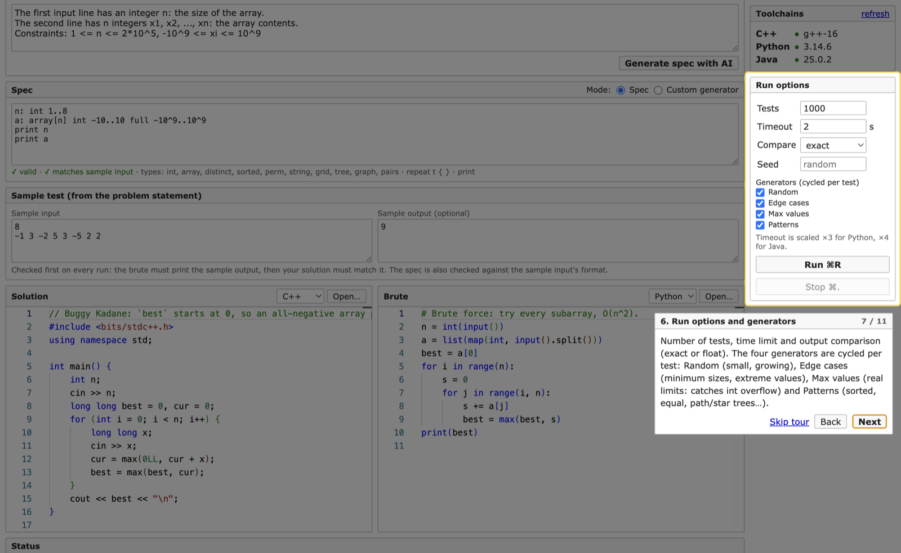

# StressLab

**Find the smallest test case where your competitive programming solution is wrong.**

StressLab is a desktop app for macOS, Windows and Linux for *stress testing*: you give it your solution, a slow-but-correct brute force and the problem's input format, and it generates thousands of random tests (small first), runs both programs, and stops at the **first test where they disagree**, showing the input, the exact failing test case and a diff of the outputs. An AI turns the problem statement into a test generator for you.

   [](https://github.com/aristoncodes/stresslab/actions/workflows/build.yml)   

Built with Electron for the *Application Development — Desktop Application* course project.

## Download

| OS | Download | First launch |
|---|---|---|
| **macOS** (Apple Silicon) | [⬇ StressLab-1.1.0-arm64.dmg](https://github.com/aristoncodes/stresslab/releases/latest/download/StressLab-1.1.0-arm64.dmg) | Drag to Applications, then **right-click → Open** the first time (unsigned app), or run `xattr -cr /Applications/StressLab.app` |
| **Windows** 10/11 (x64) | [⬇ Installer (.exe)](https://github.com/aristoncodes/stresslab/releases/latest/download/StressLab-Setup-1.1.0-x64.exe) · [portable .zip](https://github.com/aristoncodes/stresslab/releases/latest/download/StressLab-1.1.0-x64-portable.zip) | SmartScreen may warn (unsigned): **More info → Run anyway** |
| **Linux** (x64) | [⬇ .deb (Ubuntu/Debian)](https://github.com/aristoncodes/stresslab/releases/latest/download/stresslab_1.1.0_amd64.deb) · [AppImage (any distro)](https://github.com/aristoncodes/stresslab/releases/latest/download/StressLab-1.1.0-x86_64.AppImage) | `.deb`: `sudo apt install ./stresslab_1.1.0_amd64.deb`. AppImage: `chmod +x StressLab-*.AppImage`; on Ubuntu 22.04+ it may need `sudo apt install libfuse2` |

[All releases](https://github.com/aristoncodes/stresslab/releases). On first launch the app asks for a free [Groq API key](https://console.groq.com/keys) (only needed for the AI features) and then walks you through the app. You also need the compilers for the languages you use: see [Requirements](#requirements).

## Screenshots

**Main window**: problem → AI spec with the real limits, live check against the sample, four test generators, results and the AI time-complexity estimate.


| The exact failing test case | Overflow caught by the *Max values* generator |
|---|---|
|  |  |

| First-launch walkthrough | Bring your own free Groq key |
|---|---|
|  |  |

## How it works

The built-in walkthrough (Help → Show Walkthrough) shows the same steps inside the app.

| Step | You do | StressLab does |
|---|---|---|
| **1. Problem** | Paste the statement's *Input* section, constraints included, and click **Generate spec with AI**. | The AI lists every limit (`# limit n: 1..2*10^5`) and writes a small **spec**: a description of the input that StressLab turns into a random test generator. The spec is checked by a parser and against the AI's own limits; if anything is off, the AI is asked again with the exact error. |
| **2. Sample** | Paste the sample input and output from the statement. | Live check that the spec matches the sample's format ("✓ matches sample input"). On every run the sample is tested first: the brute must reproduce the expected output, then your solution must match it. |
| **3. Code** | Paste (or **Open…**) your solution and a brute force. C++, Python or Java, and they can differ. | Compiles each program once, in its own temporary folder. |
| **4. Run** | Pick the number of tests and the generators, press **Run (⌘R)**. | Generates tests that start tiny and grow, cycling through four generators (below), runs both programs with a time limit, and compares their outputs. |
| **5. Result** | Read the verdict. | *Accepted*, or a failure popup (attached to the main window, closes with Esc) with the input, **which test case** inside a multi-test input failed (as a ready-to-run `t = 1` input), a side-by-side diff, or the crash output. Notification + dock badge. |
| **6. Complexity** | Click **Estimate with AI**. | The AI reads your solution and the limits and reports time/space complexity, the bottleneck, and whether it fits the time limit. |

### The four test generators

| Generator | Sizes | Values | Catches |
|---|---|---|---|
| **Random** | small, growing over the run | small range | logic bugs, with tiny failing inputs |
| **Edge cases** | minimum (n = 1, k = 1, …) | real min, max, min+1, max−1, 0 | off-by-one, n = 1, zero handling |
| **Max values** | maximum | mostly at the problem's real limits (e.g. 10⁹) | `int` overflow that should be `long long` |
| **Patterns** | random | all-equal / sorted / reversed / alternating arrays, path & star trees, single-character strings | worst cases and wrong assumptions |

Example: an `int` array sum passes all 200 *Random* tests and fails on test 3 with *Max values* (`8000000000` expected, `-589934592` printed).

## Features

- **Three languages, mixed freely**: C++ (GCC/MinGW-w64 or Apple Clang, `bits/stdc++.h` shim included, 256 MB stack), Python 3, Java. Toolchains are detected per OS (Homebrew, MSYS2/WinLibs, `py` launcher, `JAVA_HOME`, `/usr/lib/jvm`, …); missing or broken ones are shown with the install command.
- **AI spec from the statement** with Groq (default), Gemini (falls back to `flash-lite` when busy) or local Ollama; validated by the parser, the limits it listed and the sample, with up to 2 automatic retries.
- **Spec language** (below) with a seeded generator, line-numbered errors and small-first growth, or bring your own generator program in any language.
- **Codeforces-style verdicts**: *Accepted*, *Wrong answer on test N / on sample*, *Time limit exceeded*, *Runtime error*, *Compilation error*, *Brute failed*.
- **Failure popup** (a sheet attached to the main window; Close or Esc): test number, generator and seed, input, failing test case, Monaco diff, stderr and exit code; Copy, Save as .txt, Show in Finder.
- **AI time-complexity estimate** for your solution.
- **Desktop integration** on all three OSes: native menu and shortcuts (⌘/Ctrl + O, R, ., ,), notifications, failure badge (dock on macOS, taskbar overlay on Windows, launcher badge on Linux), taskbar/dock progress bar, open/save dialogs, clipboard, first-launch walkthrough.
- **Secure by design**: sandboxed renderer, all system work in the main process, API keys encrypted by the OS (`safeStorage`) and never shown to the page.

## Requirements

The app finds compilers by itself (also outside PATH) and shows the exact install command for anything missing.

| | macOS | Windows | Linux (Ubuntu/Debian) |
|---|---|---|---|
| **C++** | `xcode-select --install` or `brew install gcc` | MinGW-w64 g++: [MSYS2](https://www.msys2.org), then `pacman -S mingw-w64-ucrt-x86_64-gcc` (WinLibs, Chocolatey `mingw` and Code::Blocks' MinGW also work) | `sudo apt install build-essential` |
| **Python 3** | `brew install python` | [python.org](https://www.python.org) or `winget install Python.Python.3.12` (the Microsoft Store alias is skipped) | `sudo apt install python3` |
| **Java (JDK 11+)** | `brew install openjdk` | `winget install EclipseAdoptium.Temurin.21.JDK` | `sudo apt install openjdk-21-jdk` |
| **Groq key** *(optional)* | [console.groq.com/keys](https://console.groq.com/keys) | same | same |

- C++ programs get a **256 MB stack** on every OS (deep recursion works like on Codeforces).
- API keys are encrypted by the OS: Keychain (macOS), DPAPI (Windows), libsecret/KWallet (Linux). On Linux without a keyring the key is kept only until you quit.
- Shortcuts use **⌘** on macOS and **Ctrl** on Windows/Linux (Run ⌘R / Ctrl+R, Stop ⌘. / Ctrl+., Open ⌘O / Ctrl+O, Settings ⌘, / Ctrl+,).

> macOS: if C++ shows **broken**, your linker and SDK are out of sync (older Xcode.app selected). Fix with
> `sudo xcode-select -s /Library/Developer/CommandLineTools`, update Xcode, or `brew install gcc`.

## Try the demos

The app opens with a demo already loaded: a **buggy** Kadane in C++ (`best` starts at 0) against an O(n²) Python brute for *Maximum Subarray Sum*.

1. Press **⌘R** → *Wrong answer* within the first few tests on a one-element array like `1 / -2`.
2. Open `samples/maxsub/sol_fixed.cpp` → *Accepted (1000 tests)*.
3. Switch the solution to Java and open `samples/maxsub/Solution.java` → *Accepted*.
4. `samples/overflow/`: the `int` sum is only caught by the *Max values* generator.
5. `samples/multitest/`: the failure window points at the failing test case inside a multi-test input.
6. Paste any problem's Input section and click **Generate spec with AI**.

## Spec language

One statement per line, `#` starts a comment. Declarations print nothing; only `print` lines produce output.

```
x: int L..R                        integer (bounds may use earlier ints: 1..n-1, 2*n, 10^9, min(n,m))
a: array[n] int L..R               n integers            (also distinct[n], sorted[n])
p: perm[n]                         permutation of 1..n
s: string[n] "a-z"                 n characters from a set (ranges allowed)
g: grid[n][m] ".#"                 n rows of m characters
e: tree n [weighted L..R]          n-1 edges "u v [w]"
e: graph n m [connected] [weighted L..R]
q: pairs[k] L..R                   k lines "l r" with l <= r
repeat t { ... }                   repeated block, e.g. test cases ("}" on its own line)
print item item ...                one output line
... L..R full A..B                 any value range: A..B are the real limits (used by Edge / Max)
# limit n: 1..2*10^5               the problem's real limits (written by the AI, checked against the spec)
```

Example for "t test cases, each with n, m, k (1 ≤ k ≤ min(n, m)) and an n×m grid of heights up to 10⁹":

```
# limit t: 1..10^4
# limit n: 1..500
# limit m: 1..500
# limit k: 1..min(n,m)
# limit a: 0..10^9
t: int 1..3
print t
repeat t {
  n: int 1..8
  m: int 1..8
  k: int 1..min(n,m)
  print n m k
  repeat n {
    row: array[m] int 0..10 full 0..10^9
    print row
  }
}
```

- **Sizes** (non-negative ints without `full`) shrink to at most 8 so failures are easy to read, but keep their real minimum. *Random* grows them from the minimum over the first quarter of the run.
- **Sample check** reads the sample in `print` order and verifies its structure (counts, test cases, string lengths and characters, sorted/distinct/perm, edges, size minimums, `full` ranges). Sizes the input never prints (like `|s|`) are inferred.

## Build from source

```bash
npm install
npm run dev          # run the app with hot reload
npm test             # 82 spec-language checks + 23 engine checks (no UI)
npm run build:mac    # → dist/StressLab-1.1.0-arm64.dmg
npm run build:win    # → dist/StressLab-Setup-1.1.0-x64.exe + portable .zip (on Windows)
npm run build:linux  # → dist/StressLab-1.1.0-x86_64.AppImage + .deb (on Linux)
```

**CI** ([`.github/workflows/build.yml`](.github/workflows/build.yml)): every push runs `npm test` on real macOS, Windows and Linux machines with g++, Python and Java. A `v*` tag builds all installers natively and attaches them to the GitHub release.

## Architecture

```
┌──────────────────────── Renderer (sandboxed, no Node) ────────────────────────┐
│  React views (one bundle, URL hash picks the view)                            │
│   #main: Problem · Spec · Sample · Solution/Brute (Monaco) · Status ·         │
│          Complexity · Sidebar · KeyPrompt · Tour                              │
│   #failure/<runId>: input · failing case · Monaco DiffEditor    #settings     │
└────────────────────────────────┬──────────────────────────────────────────────┘
                     window.api  │  contextBridge (preload/index.js)
                                 │  ipcRenderer.invoke / on — named channels only
┌────────────────────────────────▼──────────── Main process ─────────────────────┐
│ ipc.js ── validates every input ──┬─ stress.js  (one active run, dock, notify) │
│ windows.js (main/failure/settings)│     └─ runner.js  compile · run · compare  │
│ menu.js  (⌘O ⌘R ⌘. ⌘, Help)       │          └─ child_process.spawn           │
│ settings.js (safeStorage keys)    ├─ generator.js (spec → tests, sample check) │
│ llm.js (fetch: Groq/Gemini/Ollama)├─ compilers.js / toolchains.js (detection)  │
│                                   ├─ languages.js (C++/Python/Java table)      │
│                                   └─ platform.js  (all macOS/Windows/Linux     │
│                                                    differences in one place)   │
└────────────────────────────────┬───────────────────────────────────────────────┘
                                 ▼
     <tmp>/stresslab/<runId>/{solution,brute,generator}/   (deleted after the run)
     g++ / python3 / javac+java — timeout + SIGKILL, 1 MB output cap per stream
```

**Security:** every window uses `contextIsolation: true`, `nodeIntegration: false` and `sandbox: true`, with a strict Content-Security-Policy; navigation and new windows are blocked. The renderer never touches the filesystem, child processes or API keys, and every IPC input is validated in the main process. `shell:openPath` only opens files the user just saved through the app.

<details>
<summary><b>IPC channels</b></summary>

| Channel | Type | Purpose |
|---|---|---|
| `toolchains:get` | invoke | detected compilers/interpreters (optionally re-detect) |
| `spec:validate` | invoke | `{ spec, sample }` → `✓ valid` or `line N: …`, plus whether the sample matches |
| `spec:fromText` | invoke | `{ text, sample }` → AI → spec checked by parser, limits and sample (with retries) |
| `stress:start` | invoke | compile, check the sample, start a run → `{ runId, seed }` |
| `stress:stop` | invoke | kill the active run |
| `stress:progress` | event (main → renderer) | `{ test, tests, testsPerSec }`, throttled to 10/s |
| `stress:result` | event (main → renderer) | final verdict + details |
| `complexity:estimate` | invoke | `{ sol, problem, spec }` → AI time/space complexity, bottleneck, verdict |
| `failure:data` / `failure:open` | invoke | data for / (re)open the failure window |
| `file:open` / `file:saveText` | invoke | open dialog → code + language; save dialog → failing input |
| `shell:openPath` / `shell:showInFolder` | invoke | open / reveal a saved file |
| `clipboard:writeText` | invoke | copy input |
| `settings:get` / `settings:set` / `settings:test` | invoke | settings (keys never returned, only `hasKey`); test provider/model/key |
| `window:settings` | invoke | open the Settings window |
| `menu:command` | event (main → renderer) | `open` / `run` / `stop` / `tour` from the native menu |

</details>

<details>
<summary><b>Electron / Node APIs used</b></summary>

| API | Where |
|---|---|
| `BrowserWindow` (main; failure popup as a modal child/sheet; settings) | `windows.js` |
| `ipcMain.handle` / `ipcRenderer.invoke` / `contextBridge` | `ipc.js`, `preload/index.js` |
| `dialog.showOpenDialog` / `showSaveDialog` | open code into an editor, save a failing input |
| `Notification` | "Wrong answer on test 37" when a run fails |
| `Menu` (app, File, Edit, Run, View, Window, Help + accelerators) | `menu.js` |
| `clipboard` | copy the failing input / test case |
| `shell.openPath` / `showItemInFolder` / `openExternal` | saved files, external links |
| `safeStorage` | encrypt API keys in `userData/settings.json` (Keychain / DPAPI / libsecret) |
| `app.dock.setBadge` / `BrowserWindow.setOverlayIcon` / `app.setBadgeCount` | failure badge on macOS / Windows / Linux |
| `BrowserWindow.setProgressBar` | dock / taskbar progress while running |
| `app.getPath('userData')`, `process.resourcesPath` | settings file, bundled `bits/stdc++.h` |
| `child_process.spawn` | compile and run programs (timeouts, kill on Stop) |
| `fetch` (Node built-in) | Groq / Gemini / Ollama HTTP APIs |

</details>

## Project layout

```
src/main/          index · windows · menu · ipc · stress · runner · languages · compilers
                   toolchains · generator · llm · settings · paths · platform
src/preload/       contextBridge API (window.api)
src/renderer/src/  React app: views/ (Main, Failure, Settings), components/, lib/
src/shared/        verdict wording shared by main and renderer
resources/include/ bits/stdc++.h shim
samples/           maxsub · multitest · overflow demo problems
scripts/           gen-test.mjs (spec language) · smoke.mjs (engine)
docs/screenshots/  README images
.github/workflows/  CI: tests on macOS/Windows/Linux, installers, releases
```

Project documents: [PRD.md](PRD.md) (features and scope), [PRD-cross-platform.md](PRD-cross-platform.md) (Windows/Linux), [DESIGN.md](DESIGN.md) (UI), [PROGRESS.md](PROGRESS.md) (build log).
